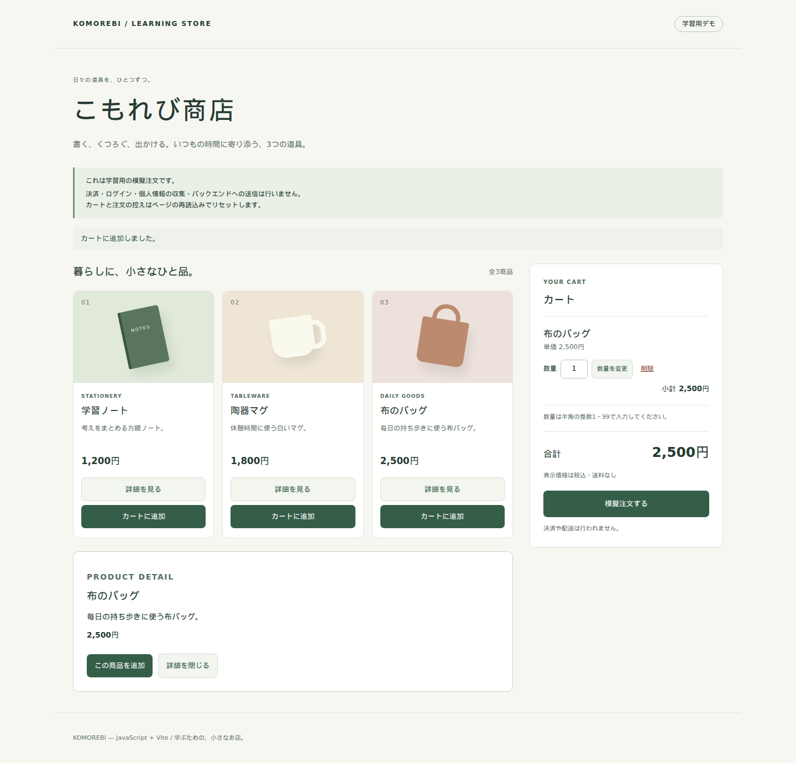
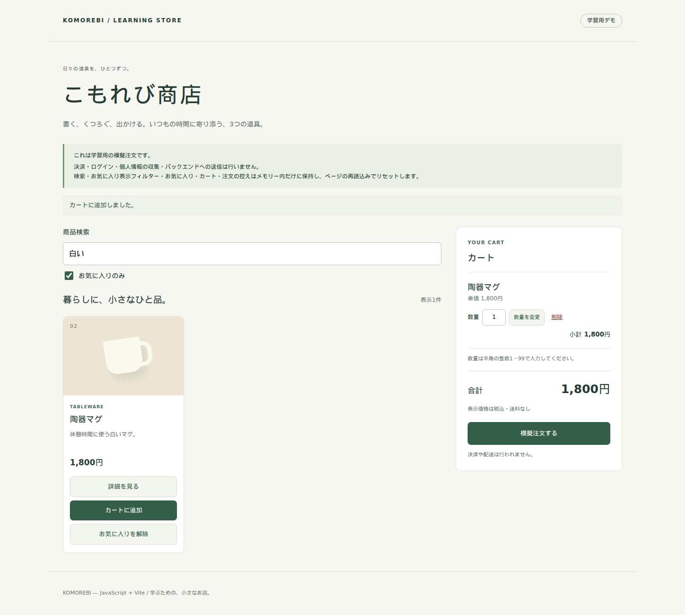
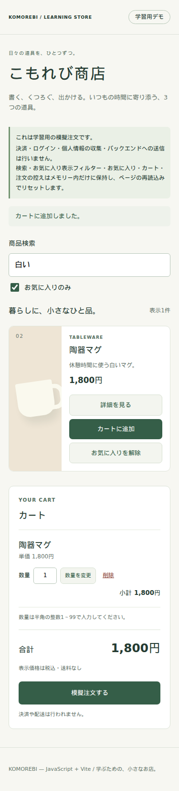

# はじめての musubix6：ミニECを作り、Worktreeで機能を追加する

GitHub Copilot CLIに日本語で依頼し、商品一覧・カート・模擬注文を備えたWebアプリを作るチュートリアルです。
初版を完成させた後、商品検索とお気に入りを別々のWorktreeで追加し、1つのアプリに統合します。

対象は、Git・npm・JavaScriptの基本操作は分かるものの、musubix6・SDD/TDD・Worktreeを初めて使う方です。  
対象バージョンは **musubix6 Ver. 0.2.0**、実験環境の確認日は **2026年10月22日** です。

> [!NOTE]
> 実験に使ったのはGitHub Copilot CLI版です。Claude Code版については導入先と公式仕様を比較していますが、Claude Codeで同じアプリを開発し直す実験は行っていません。

## このチュートリアルで作るもの

題材は、JavaScriptとViteで動く学習用のミニECです。Viteは、開発用サーバーと配布用ファイルのビルドを担当します。ReactなどのUIフレームワークは使いません。

| 段階 | 利用者ができること | 学ぶこと |
| --- | --- | --- |
| 初版 | 商品一覧・詳細を見る、カートの数量を変える、模擬注文する | 自然言語の依頼を仕様とテストに落とし込む |
| 追加開発 | 商品を検索する、お気に入りを管理する | 完成後も追加要件から開発を始める |
| 並列開発と統合 | 追加した2機能を同じ画面で使う | Worktreeで作業を分離し、仕様・コード・証拠を統合する |

実決済、会員ログイン、個人情報、実在する店舗への注文送信は扱いません。初版のカートと注文はメモリー上に保持し、再読込みするとリセットします。本番ECサイトの構築手順ではありません。

## musubix6・Copilot・人間の役割

musubix6は、AIそのものでも、独立したコーディングサービスでもありません。AIエージェントに渡す **開発手順のスキル** と、仕様・テスト・実行証拠を検査する **CLIスクリプト** を提供するnpmパッケージです。

| 担当 | このチュートリアルで行うこと | 行わないこと |
| --- | --- | --- |
| 人間 | 目的・必要な動作・許容できるリスクを決める、必要な質問に答える、画面を確認する、公開などの重要操作を承認する | すべての実装コードを手書きする |
| GitHub Copilot CLI | スキルを読み、仕様・設計・テスト・実装を書く。コマンドを実行し、結果を受けて修正する | 実行していない確認を成功扱いにする |
| musubix6のスキル | 要件の聞き取り、設計、独立レビュー、Red→Green、文書化の進め方を案内する | AIモデルや課金、GitHubの認証を提供する |
| musubix6の`sdd.mjs` | REQ/TEST/CODEの対応、仕様ロック、テストの証拠履歴、設定した検証コマンドを検査する | 要件やテストの十分性、レビューの独立性、無欠陥を自動保証する |

たとえば「数量は1～99」という要件を、人間が自然言語で伝えます。Copilotは境界値のテストと実装を書きます。musubix6は、要件とテストが対応しているか、テストを先に失敗させた証拠があるかなどを検査します。**コードを書く主体はCopilotであり、musubix6が単独でアプリを生成するわけではありません。**

### AIが自律的に進めるための判断基準と証跡を整える

AIが速くコードを書いても、すべての中間結果を人間が確認・承認する運用では、確認待ちがボトルネックになり得ます。musubix6は、**AIが自律的に開発を進めるための判断基準と、検査可能な証跡を整える仕組み** です。

要件とPASS条件は「何を満たすか」、テストと実行証跡は「何を確認したか」を示します。Copilotはこれらを根拠に、次の工程へ進むか、修正するか、止まって人間に確認するかを判断します。証跡は、人間が後から作業を確認するためだけでなく、AI自身が次の行動を決めるためにも使います。

通常の開発では、すべての段階で人間の承認を待つわけではありません。安全な仮定とAIレビューで進められる段階は自動で進めます。一方、目的や許容リスクの決定、解決できない製品上の判断では、人間の判断を省略しません。秘密情報、破壊的な操作、セキュリティ方針の緩和、公開・リリースなども同様です。

証跡があるだけで、要件やテストが十分だと保証されるわけではありません。musubix6が単独ですべてを自動判断するのではなく、Copilotがスキルに従い、設定した範囲の検査結果を確かめて進めます。

<details open>
<summary>補足：Copilot単体でもできることと、musubix6が追加するもの</summary>

### Copilot単体との違いは、作業能力ではなく手順と証拠の管理

**CopilotにSDDやTDDができない、という意味ではありません。** Copilotは、依頼と実行環境に応じて、要件定義やEARS形式の文章作成、テスト作成を行えます。コマンド実行やレビュー、Git Worktreeでの並列開発も、依頼と実行環境に応じて行えます。

ただし、「SDD/TDDで開発して」と依頼することと、その手順を守った証拠がリポジトリに残り、コマンドで検査できることは別です。

たとえば、Copilotが「テストはすべて成功しました」と答えても、その文章だけでは次のことは確認できません。

- どの要件を、どのテストで確認したか。
- そのテストが、実装前に期待した理由で失敗したか。
- 実行後に仕様・テスト・検証コマンドが変わっていないか。
- 必要な確認が実行され、スキップや未確認と区別されているか。

ここでいう「Copilot単体」は、musubix6や同等の独自ルール・検証スクリプトを追加していない状態です。Copilotに同等の仕組みを作らせることもできます。musubix6の価値は、Copilotでは原理的に不可能な作業を代行することではなく、**毎回作り直さずに使える手順と検査の仕組みを提供すること** にあります。

</details>

## SDDとTDDを、カートの例で理解する

### SDD：作る前に「満たす条件」を明文化する

SDDは **Spec-Driven Development（仕様駆動開発）** です。「カートを作る」という依頼を、そのまま実装へ渡さず、判定できる仕様にします。

```text
カートの数量を変更するとき、数量が1～99の整数であれば変更する。
数量が0、100、小数などの不正値なら、カートを変えずに理由を示す。
```

仕様には`REQ-...`という要件IDを付け、対応するテストや実装をたどれるようにします。

musubix6では、要件を **EARS（Easy Approach to Requirements Syntax）** 形式で記述します。EARSは、発生するイベントやシステムの状態と、期待する応答を結び付ける要件の記述方法です。

**SDDという開発手法そのものがEARSと同じ、というわけではありません。musubix6では、SDDの要件記述にEARS形式を採用しています。** 設計、テスト結果、運用手順まで、すべてをEARSで書くわけではありません。

### TDD：期待する失敗を先に確認する

TDDは **Test-Driven Development（テスト駆動開発）** です。基本は次の繰り返しです。

| 段階 | カートの例 | 確認すること |
| --- | --- | --- |
| Red | 「数量を100へ変更してもカートが変わらない」というテストを先に書く | テストを正常に起動でき、期待値の比較で失敗する |
| Green | 数量の検査を実装する | 同じテストが成功する |
| Refactor | 重複した数量検査を整理する | 仕様とテストの意味を変えず、成功が続く |

テストファイルの読み込みエラーや、依存パッケージ不足で止まっただけでは、ここでいうRedの証拠になりません。「失敗なら何でもよい」のではなく、まだ満たしていない要件をテストが検出したことを確認します。

「何でも拒否する」実装でも、不正入力のテストだけなら成功してしまいます。そのため、数量3や99を受け付ける確認も必要です。

さらに、修正後の実装を一時的に壊し、テストがそれを検出するか確かめる方法を **mutationによる検査** と呼びます。たとえば上限99の検査を外したときに、数量100のテストが失敗するかを見ます。壊した実装を残さず、復元後の成功も確認します。

### Vibe Codingとの違いは、自然言語を使うかどうかではない

Vibe Codingは、自然言語でAIに依頼し、動作を見ながら方向を調整する開発スタイルを指す言葉です。使われ方に幅があり、自然言語で依頼する開発すべてを「仕様もテストもない」と決め付けることはできません。

このチュートリアルも、実装の依頼には自然言語を使います。重視する違いは次の点です。

| 観点 | その場の対話と動作確認だけで進める場合 | このチュートリアルのSDD/TDD |
| --- | --- | --- |
| 正しさの基準 | 会話や見た目の印象に残りやすい | 判定できる仕様と要件IDに残す |
| 実装の順序 | まず動くコードを生成して調整する | 期待する失敗を確認してから実装する |
| 追加要件 | 新しい依頼で既存動作を変えやすい | 既存仕様への影響を調べ、回帰テストで確認する |
| 完了の判断 | 「動いた」「AIが完了と言った」 | テスト、gate、実ブラウザーの結果を区別して確認する |
| 後からの説明 | 会話履歴を探す必要がある | 仕様・テスト・実装・証拠を対応付ける |

SDD/TDDでも、仕様に書かなかった動作や、テストで検出できない欠陥は残り得ます。ツールのPASSを、利用者の目的をすべて満たした保証と取り違えないでください。

## GitHub Copilot CLI版とClaude Code版の違い

musubix6のnpmパッケージは共通です。`init`の`--host`で、スキルのコピー先を選びます。

| 項目 | GitHub Copilot CLI | Claude Code |
| --- | --- | --- |
| インストール指定 | `--host copilot`。省略時もこちら | `--host claude` |
| プロジェクト内の配置先 | `.github/skills/` | `.claude/skills/` |
| 初期化するスキル数 | 10 | 9 |
| `agent-watchdog` | 対象。ホストのスケジュール・エージェント機能に依存 | 対象外 |
| 質問・承認 | ホストの`ask_user` | ホストの`AskUserQuestion` |
| 独立レビューの入口 | Copilotの`/rubber-duck`や利用可能な独立エージェント | 汎用または自作の独立サブエージェント。Copilotの同名コマンドを前提にしない |
| モデル・料金・ログイン・権限 | Copilot側で設定 | Claude Code側で設定 |
| この文書の検証範囲 | アプリ開発の実験対象 | インストール経路と公式仕様の比較。ライブ開発は未確認 |

### Rubber-duck Reviewは「名前」と「役割」を分ける

**Copilot固有の`/rubber-duck`を、Claude Codeでもそのまま使えるとは説明しません。** 一方、Claude Codeにも独立したコンテキストで作業するサブエージェントの仕組みがあります。そのため、「Claude Codeでは独立した批評レビュー自体ができない」とするのも正確ではありません。

Claude Codeでは、たとえば次のように依頼する方法があります。これは公式のサブエージェント機構に基づく **依頼例** であり、本チュートリアルで実行したプロンプトではありません。

```text
この仕様を、実装担当とは別の読み取り専用サブエージェントに批評させてください。
曖昧な要件、境界条件、テストできない条件を指摘させてください。
独立したエージェントを起動できなければ、その制限を報告し、
自分で読み直しただけの結果を独立レビューとして記録しないでください。
```

musubix6は、Claude Code用の`.claude/agents/`定義や、Copilotの組込みエージェントを一緒にインストールするものではありません。利用可能なツールは、ホストのバージョンと設定に依存します。

`--host both`は両方のディレクトリへスキルをコピーする指定です。2つのAIを同時起動したり、両方の課金をまとめたりする機能ではありません。`agent-watchdog`を明示的に選んだClaude/both向けインストールは、書込み前に拒否されます。

## 始める前に用意するもの

本編はLinux/WSL2環境を基準にしています。別OSでは、パスやコマンドを調整してください。

| 用意するもの | 用途と確認方法 |
| --- | --- |
| Node.js 24系とnpm | `node --version`、`npm --version`。musubix6自体の要件はNode.js 20以上ですが、本実験のアプリ環境は24系に固定 |
| Git | `git --version`。コミット用の名前とメールが設定済みであること |
| GitHub Copilot CLI | `copilot --version`。利用可能な契約とログインが必要 |
| GitHub CLI | `gh --version`、`gh auth status`。非公開リポジトリの作成・保存に使用 |
| ブラウザーを使える環境 | 手元での画面確認と、Playwrightによる自動操作に使用 |
| パッケージを取得できるネットワーク | npm依存と、必要なブラウザー実行ファイルの取得に使用 |

本実験では、Copilot CLI **1.0.102**、Node.js **24.21.0**、npm **12.2.0** を使いました。開発モデルはGPT-6.1 Sol、独立レビューはClaude Sonnet 5.5を指定しています。利用できるモデルは読者の契約とホストに依存します。musubix6を導入しても、利用できるモデルが増えるわけではありません。

> [!IMPORTANT]
> 対話モードの`copilot`を使う場合、ツールやパスの権限は画面の要求を確認して許可します。本文の依頼を実行するために、すべてのパス・URL・ツールを無条件に許可する必要はありません。

## 1. 新しいリポジトリを作る

以下では`$HOME/Github/musubix6-tutorial`を使います。すでに同名の作業がある場合は、空の別ディレクトリを選んでください。既存ディレクトリの内容は削除しません。

```sh
mkdir -p "$HOME/Github/musubix6-tutorial"
cd "$HOME/Github/musubix6-tutorial"
git init --initial-branch=tutorial/mini-ec
```

この後も使う場所なので、`pwd`で現在のパスを確認します。実験では`/home/nahisaho/Github/musubix6-tutorial`を使いました。大文字・小文字を区別する環境では、`Github`と`GitHub`は別のディレクトリです。

GitHub側にも非公開リポジトリを用意します。`OWNER`は、ご自身のGitHubアカウント名に置き換えます。

```sh
OWNER=your-github-account
gh repo create "$OWNER/musubix6-tutorial" --private --source=. --remote=origin
gh repo view "$OWNER/musubix6-tutorial" --json nameWithOwner,isPrivate,url
```

確認結果の`isPrivate`が`true`なら、非公開で作成されています。リポジトリを作成する段階では、まだコミットをpushしていません。

実験用のGitHubリポジトリも非公開です。他の読者が実験者のリポジトリをcloneできることは前提にしません。ご自身の新規リポジトリで、本文のプロンプトから開発してください。

## 2. musubix6をインストールしてCopilotを起動する

まず、アプリの依存バージョンとコマンドを`package.json`に記録します。

```json
{
  "name": "musubix6-tutorial",
  "version": "0.1.0",
  "private": true,
  "type": "module",
  "engines": { "node": ">=24" },
  "scripts": {
    "dev": "vite --host 127.0.0.1",
    "build": "vite build",
    "preview": "vite preview --host 127.0.0.1",
    "test": "node --test test/*.test.mjs",
    "test:e2e": "playwright test",
    "lint": "eslint src test e2e"
  },
  "devDependencies": {
    "@playwright/test": "1.64.1",
    "eslint": "9.39.5",
    "musubix6": "0.2.0",
    "vite": "8.3.5"
  }
}
```

`private: true`は、アプリを誤ってnpmへ公開しないための指定です。GitHubリポジトリを非公開にする指定とは別です。
依存バージョンは、実験の条件を再現するために固定しています。通常の開発で利用可能な最新版を選ぶこととは区別します。

`.gitignore`も作成します。

```gitignore
node_modules/
dist/
playwright-report/
test-results/
.env
.env.*
```

次を実行します。

```sh
npm install --no-audit --no-fund
npx musubix6 --version
npx musubix6 init . --host copilot
npx playwright install chromium
```

`musubix6 --version`が`0.2.0`で、`.github/skills/`に10個のスキルディレクトリができることを確認します。依存バージョンを再現するため、`package-lock.json`も保存します。`node_modules/`、`dist/`、`test-results/`、`playwright-report/`はGitへ入れないよう`.gitignore`に指定します。

本実験では、ESLint 9.39.5がサポート終了版であるというnpmの警告が出ました。この版を固定した理由は、musubix6 0.2.0のJavaScript診断がESLint 9系を前提にしているためです。この教材の検証条件であり、他の製品でも古い版を使い続けることを勧めるものではありません。

この時点では、アプリのソースやテストはまだありません。準備用のファイルをコミットし、初版開発の開始地点を残します。

```sh
git add package.json package-lock.json .gitignore .github/skills
git commit -m "chore: bootstrap mini EC tutorial"
git push -u origin tutorial/mini-ec
```

まだテストを作っていないので、この段階で`npm test`が成功することを完成条件にはしません。

### Claude Codeへ導入する場合の分岐

本編のCopilot用`init`の代わりに、次を実行します。

```sh
npx musubix6 init . --host claude
```

`.claude/skills/`へ9個の共有スキルをコピーします。Claude Codeをこのプロジェクトから起動し、そのホストでスキルが見えているかを確認します。本編と同一の対話・レビュー結果になることは、ここでは確認していません。

### 同梱の文書作成・日本語添削・コンテナー操作スキルを知る

musubix6は、SDD/TDDの手順だけでなく、文書作成や実行環境の操作を支援するスキルも同梱しています。`--only`で対象を絞らない標準の`init`では、次の3つはCopilot版にもClaude Code版にも含まれます。

| スキル | 担当すること | このアプリでの依頼例（未実行） |
| --- | --- | --- |
| [`tech-writer`](../.github/skills/tech-writer/SKILL.md) | README、設計書、テスト計画書などの構成を整え、対象読者に必要な情報をまとめる | 「このミニECの起動方法、機能、制限をREADMEにまとめてください」 |
| [`japanese-prose`](../.github/skills/japanese-prose/SKILL.md) | 日本語の誤字・文法・用語・読みやすさを確認する。GiNZAによる診断と、編集前後の保護内容検査を使う | 「READMEの日本語を添削してください。コマンド、数値、機能の制限は変えないでください」 |
| [`wslc-containers`](../.github/skills/wslc-containers/SKILL.md) | WindowsのWSLコンテナーCLIで、イメージのビルド、コンテナーの起動・一覧・ログ確認・停止などを行う | 「WSLのコンテナー一覧と、指定したコンテナーのログを確認してください」 |

`tech-writer`が文書の構成と情報の不足を確認し、`japanese-prose`が文単位の日本語を整える、という役割分担です。技術文書を日本語で作る場合は、この2つを組み合わせます。文章が読みやすくなっても、仕様や実装の正しさが保証されるわけではありません。

日本語の診断スクリプトには、Python 3.10以上と`uv`が必要です。GiNZAなどの依存は、初回の`uv run`で取得します。`tech-writer`の構造lintはPythonだけでも実行できます。準備方法は[日本語READMEの「必要なもの」](../README-ja.md#必要なもの)を参照してください。

`wslc-containers`は、Windows側のWSL 2.9.3以上と`wslc.exe`を利用できる、WSL内のセッション向けです。Docker Desktopは不要ですが、Docker CLIと互換ではありません。本チュートリアルではWSLコンテナー内でアプリを動かす実験は行っておらず、本編を進めるための必須手順にもしていません。

### 名前の似た初期化コマンドを区別する

| コマンド | 初期化するもの |
| --- | --- |
| `npx musubix6 init . --host copilot` | プロジェクトへコピーするスキル |
| `npx musubix6 sdd init` | アプリの`.sdd`設定。以降の開発依頼の中で実行する |
| Copilotの`/init` | Copilot向けのプロジェクト説明。musubix6のインストールではない |

準備ができたら、同じディレクトリで対話を開始します。

```sh
copilot
```

Copilotで`/skills`を開き、スキルが認識されていることを確認します。新規にコピーした直後で認識されない場合は、このディレクトリでセッションを起動し直します。

`/model`で開発用のモデルを選び、`/subagents`でレビュー担当のモデル設定を確認します。プロンプトにモデル名を書くだけで、ホストの設定が必ず切り替わるわけではありません。実際に使われたモデルも、実行結果で確認してください。

本実験では、保存したプロンプトを非対話の`copilot -p`へ渡し、主モデルを`--model gpt-6.1-sol`で指定しました。本編の対話手順は、読者が権限要求を確認しながら進めるためのものです。レビュー担当にはClaude Sonnet 5.5を明示しましたが、そのモデルを利用できるかはホスト側の条件に依存します。

また、読者の実験ではSDDコマンドの入口を最初から **`npx musubix6 sdd`に統一** してください。以下の保存済みプロンプトは実験時の全文なので、読者が使う際は、次の補足も添えます。これは実験の保存済み本文とは別の、読者向けの指示です。

```text
SDDコマンドの入口はnpx musubix6 sddに統一してください。
実際のホスト設定と使用モデルを確認し、未実行の検証を成功扱いにしないでください。
```

## 3. 自然言語で初版の要件を伝える

最初の依頼で、「何を作るか」と「どう確かめるか」を一緒に伝えます。下記は、初版の実験で実際にCopilot CLIへ渡したプロンプトです。実装コードの貼り付けではありません。

<details open>
<summary>実際に入力したプロンプト全文</summary>

```text
このリポジトリに、JavaScriptとViteで学習用のWebショッピングサイトを作ってください。
musubix6はインストール済みです。要件定義、設計、独立レビュー、テスト作成、実装、検証の順で進め、使うスキルは依頼に合わせて選んでください。

初版で実現すること:
- 日本語の画面に商品一覧と商品詳細を表示する。商品データは固定の3件でよい。
- 商品をカートに追加し、数量を変更し、削除できる。数量は整数1～99、金額は整数の円で扱う。
- 同じ商品を追加したら数量を増やす。99を超える操作や不正な数量では、状態を変更せず理由を表示する。
- 商品ごとの小計とカート合計を表示する。
- 空のカートでは注文できない。注文すると明細と合計の控えを表示し、成功後にカートを空にする。
- これは模擬注文で、決済、ログイン、個人情報、バックエンドへの送信は行わない。
- 初版のカートと注文はページ再読込みでリセットする。この制限は画面とREADMEに表示する。
- 商品詳細、カート操作、注文完了まで、実ブラウザーで動くことを確認する。

進め方:
- 不明点は安全な学習用の仮定を記録して進める。元の目的を変える判断、公開や秘密情報が必要な操作は止める。
- 仕様にREQ ID、具体的なPASS条件、反例、TEST ID、六段階の失敗リスクを記録する。状態や金額のルールはT2として設計とレビューを行う。
- 最初に隔離した小さな実験でViteと実ブラウザーを動かせることを確認する。
- 独立したレビュアーを使い、仕様・テスト妥当性と状態・境界条件の観点を確認する。レビューに使うモデルはClaude Sonnet5.5、開発はGPT-6.1 Solとする。
- 各要件のテストで、実装前に意味のあるassertion Redを確認してから最小実装し、Greenを記録する。setup失敗、skip、通っているテストをRedにしない。
- 各変更機構の隔離mutationを実行し、テストが壊れた実装を検出すること、復元後に通ることを確認する。観測結果を同じ仕様と実行ログに記録する。
- node --testで実行する小さなテストと、実ブラウザーの操作確認を用意する。npm test、npm run build、JavaScript用診断、最後のfull gateを実行する。
- 診断は明示的に --profile javascript を指定する。scan.includeはsrcとテストに限定し、コピーしたスキル本体をアプリのtraceに入れない。
- packageの依存バージョンはすでに固定されている。必要な追加・変更はmanifestに明示してからインストールする。
- 読者に不要な大規模な仕組みやバックエンドは追加しない。機能追加用に、UI統合の入口は小さな関数に分けておく。
- 初版の結果をtutorial/evidence/に保存し、未実行・失敗・未確認を区別する。最初の完成コミットを作る。コミットにはCo-authored-by: Copilot <223556219+Copilot@users.noreply.github.com>を含める。
- 既存の.gitignoreを尊重し、node_modules、dist、認証情報、個人情報はコミットしない。
- コピーした.github/skillsやnode_modules内のmusubix6を修正しない。gateが拒否したら証拠を修正・再取得し、検証を弱めて通さない。
- npm公開、デプロイ、GitHub Release、Gitタグ、git push、外部リポジトリへの書込みは行わない。長時間サーバーは検証後に停止する。
- 商品検索とお気に入りはまだ実装しない。初版が完了した時点で止まり、実行したコマンド、テスト結果、残る制限を簡潔に報告する。
```

</details>

この依頼には、利用者向けの要件と、AIに守ってほしい開発手順の両方が含まれています。日常の短い依頼を毎回ここまで長くする必要はありません。今回は再現実験の条件を明示するため、テストの順序や記録先も指定しました。

仕様を読んだ際は、少なくとも次の条件が文章とテストで一致しているか確認します。

| 操作・入力 | 初版で期待する結果 |
| --- | --- |
| 初期表示 | 固定商品3件が表示される |
| 数量1と99 | 有効な数量として扱う |
| 数量0、100、小数 | 状態を変えず、拒否理由を示す |
| 同じ商品を再追加 | 別行を増やさず数量を増やす。上限は99 |
| 空のカートで注文 | 注文を成立させない |
| 商品のあるカートで注文 | 明細と合計の控えを残してカートを空にする |
| ページの再読込み | 初版のカートと注文は初期状態に戻る |

注文画面を見て「買えた」と判断しても、決済やサーバー保存を検証したことにはなりません。この教材では、実際のお金や個人情報を扱わない範囲を仕様で固定しています。

### EARSで「いつ・どの条件で・何をするか」を明確にする

「カートを使いやすくする」だけでは、実装者もテストを書く人も合格条件を決められません。EARSでは、たとえば次のように動作を分けます。以下はよく使う構文の例であり、EARSのすべての構文を列挙したものではありません。

| 要件の種類 | 英語の構文例 | カートに当てはめた意味 |
| --- | --- | --- |
| イベントへの応答 | `When <event>, the system shall <response>.` | 利用者が有効な数量への変更を確定したとき、数量を更新する |
| 状態に応じた動作 | `While <state>, the system shall <response>.` | カートが空の間、注文確定ボタンを無効にする |
| 望ましくない条件への対応 | `If <unwanted condition>, then the system shall <response>.` | 数量が不正な場合、カートを変更せずに拒否理由を示す |

`shall`は、システムが満たさなければならない動作を示します。日本語で書く場合も、条件・対象・期待動作が読み取れるようにします。

構文に沿っていても、「有効な数量」や「不正」の定義がなければ曖昧さは残ります。数量の型、上限と下限、拒否したときの状態、利用者への通知まで具体化して初めて、テストに落とし込めます。EARSの語句を覚えることより、「どの入力に対して、何を確認すれば合格か」を具体化することが先です。

### 要件IDと合格条件を付け、テストに落とし込む

以下は仕組みを説明するための要件例で、この後に紹介する実験仕様の引用ではありません。対象はカート内に存在する商品とし、有効な数量を **数値型の整数1～99** と定義します。

| ID | EARS形式の要件 | 対応するテスト |
| --- | --- | --- |
| REQ-CART-001 | 利用者が有効な数量への変更を確定したとき、システムは対象商品の数量を指定値に更新しなければならない。 | TEST-CART-001 |
| REQ-CART-002 | 数量が数値型の整数1～99ではない場合、システムはカートを変更せず、拒否理由を利用者に示さなければならない。 | TEST-CART-002 |

期待結果は、実装が現在返している値ではなく、この要件から決めます。

| 入力例 | 期待結果 | 目的 |
| --- | --- | --- |
| `2`から`3`への変更 | 数量が`3`になる | 正常入力の確認 |
| `1`、`99` | 指定値を受け付ける | 許容範囲の境界を確認 |
| `0`、`100`、`1.5` | カートを変更せず、理由を示す | 範囲外・小数の拒否を確認 |
| 数値ではなく文字列の`"2"` | カートを変更せず、理由を示す | 入力の型を確認 |

この表は、数量を受け取る処理への入力例です。画面の入力欄が返す文字列を数値へ変換する処理とは区別します。また、示した入力例だけで、すべての不正入力を網羅したことにはなりません。

EARSに沿った文章か、条件に抜けがないかは、仕様レビューで確認します。musubix6のCLIは、EARSの構文や要件の意味を検証しません。IDの対応が正しくても、要件自体が間違っていれば目的には合いません。

## 4. Copilotが作った仕様・テスト・実行証拠を読む

実験では、Copilotが初版の仕様を`.sdd/specs/shop.md`へ記録しました。仕様は、実装後の説明書ではなく、実装前に満たす条件を決めるための文書です。

本章では、AIが作った成果物と実行済みの証拠を読み、仕組みを学びます。人間がすべての中間結果を逐一承認する手順ではありません。通常はAIが検証結果を確認して開発を進め、人間は必要な確認や重要な判断に集中します。

| ファイル | 読者が確認すること |
| --- | --- |
| `.sdd/specs/shop.md` | 8要件、入力と期待結果、設計、安全な仮定、反例、実測結果 |
| `test/shop.test.mjs` | 商品・数量・金額・注文状態のテスト |
| `test/browser.test.mjs` | 実Chromiumで画面を操作するテスト |
| `test/journey.mjs` | 開発サーバーとビルド済みサイトで共用する画面操作 |
| `e2e/shop.spec.js`、`playwright.config.js` | `npm run test:e2e`の対象と設定。ビルド済みサイトをpreviewで起動して操作する |
| `src/catalog.js`、`src/shop.js`、`src/ui.js` | 商品、状態、画面の実装を分ける構造 |
| `.sdd/tdd.jsonl` | Red→Greenなどの実行履歴。手で成功を書き込むファイルではない |
| `.sdd/approvals.json`、`.sdd/review-shop.md` | 仕様のハッシュロックと独立AIレビューの記録。人間の承認を意味しない |
| `tutorial/evidence/` | 失敗を含む実行ログ、mutation、画像、結果の要約 |

生成するファイル名は、AIの判断やモデルによって変わる場合があります。読者の実験では、Copilotに対応するファイルを示させてください。

### スキルの「指示」とCLIの「機械検査」を分ける

スキルはAIへの手順書です。一方、CLIの検査は、保存されたファイルや実行結果を調べます。この2つを混同しないことが重要です。

| 開発で確認したいこと | スキルが案内すること | CLIが検査すること |
| --- | --- | --- |
| 何を作るか | 要件を聞き取り、EARS形式で記述する | 要件IDを読み取り、対象の要件とテストの対応を調べる |
| 何をテストしたか | 要件・テスト・実装にIDを付ける | REQ/TEST/CODEの参照やアノテーションの整合性を調べる |
| テストを先に失敗させたか | 期待した失敗を確認してから実装する | Red→Greenの記録、テストなどのハッシュ、履歴のチェーンを検査する |
| レビューした仕様と同じか | 仕様・設計をレビューしてロックする | T2などロックが必要な仕様について、記録と現在の内容を照合する |
| 今の状態で合格か | 設定した検証を実行し、未確認を成功扱いにしない | `gate`でトレース・ロック・証拠と設定されたチェックを確認する |

ハッシュは、ファイルの内容から計算する照合用の値です。仕様やテストが変わったのに、変更前の成功結果だけを使い続けないために利用します。履歴のチェーンは、前の記録と次の記録をハッシュでつなぐ仕組みです。これらは内容や履歴の不整合を検出するためのもので、記録の完全な改ざん防止や、内容の正しさの証明ではありません。

たとえば、上限を99から50へ変えたら、以前の「99を受け付ける」テストの成功だけでは新しい仕様を確認できません。仕様・テストを更新し、必要なレビューと検証をやり直します。変更後も昔のPASSをそのまま根拠にしないための仕組みが、musubix6の役割です。

### 要件ID・テストID・実装IDをたどる

初版の数量変更要件は、次のように記録されました。

```text
REQ-SHOP-003:
数量変更時、システムは数値型の整数1～99だけを受け付け、
不正値または未登録IDなら状態を変更せず日本語の理由を返さなければならない。
```

対応するテストには`TEST-SHOP-003`と`@verifies REQ-SHOP-003`、実装には`CODE-SHOP-003`と`@implements REQ-SHOP-003`が付きます。要件・テスト・実装の対応をたどれることを **トレーサビリティ** と呼びます。この対応を検査するのが **trace（追跡関係の検査）** です。

```sh
npx musubix6 sdd context shop
npx musubix6 sdd trace
npx musubix6 sdd tdd check
```

`context`は選んだ仕様を読むためのコマンドです。読んだことだけで、テストや承認が済んだことにはなりません。`trace`は対応関係、`tdd check`はTDD証拠を検査します。

musubix6では変更のリスクをT0/T1/T2に分けます。文章だけの修正はT0、通常の動作変更はT1、状態・金額・並行処理など慎重な設計が必要な変更はT2です。今回の初版はT2として扱い、設計、実行環境を確かめる小さな実験、独立レビュー、仕様ロックを行いました。

### 実行済みのRed→Greenを確認する

ここは初版の実装後なので、新しいRedを記録する段階ではありません。`.sdd/tdd.jsonl`と`tdd check`の結果から、対象のテストにRed→Greenの履歴があるかを確認します。意味のある失敗だったかは、保存した失敗ログも読みます。

<details>
<summary>参考：実装前後のコマンド形式（この段階では再実行しない）</summary>

以下は、今回使ったコマンド形式です。読者が手動で試す場合も、Redは実装前のテストに対して実行します。完成済みのコードをそのままテストして成功した結果を、Redとして登録することはできません。

```sh
npx musubix6 sdd tdd red TEST-SHOP-003
# Copilotが仕様に合わせた実装を行った後
npx musubix6 sdd tdd green TEST-SHOP-003
```

テストを書き換えて都合のよい成功にすると、RedとGreenの間のテストハッシュが一致しません。正当な要件変更でテストを変える場合は、仕様への影響を調べ、変更した条件について新しいRed→Greenを取得します。

</details>

### gateとJavaScript診断を別々に確認する

**gate** は、仕様ロック、追跡関係、証拠履歴、プロジェクトに設定した検証コマンドをまとめて実行する完了確認です。JavaScript診断は、ESLintによる静的な問題の確認です。診断がPASSでも、gateやブラウザーテストの代わりにはなりません。

```sh
npm test
npm run build
npm run lint
npm run test:e2e
npx musubix6 sdd diagnostics --root . --profile javascript --json
npx musubix6 sdd gate
```

`test:e2e`はビルド済みサイトを操作するため、先に`npm run build`を実行します。JavaScript診断では`--profile javascript`を省略しません。省略時はTypeScript用の診断になるため、このアプリの確認条件と異なります。

必要なチェックがスキップされて`INCOMPLETE`になった結果は、PASSではありません。未確認と合格を区別し、必要な確認を実行します。

本実験では`.sdd/config.json`の`scan.include`を`src/**/*.js`、`test/**/*.mjs`、`e2e/**/*.js`に限定しました。コピーした`.github/skills/`は、教材アプリの要件やテストではないため、アプリのtrace対象へ入れません。これは、アプリのテストを省略してよいという意味ではありません。

**traceの対象設定と、ESLintの対象設定は別です。** `scan.include`を指定しても、診断で列挙するファイルは限定されません。本実験の`eslint.config.js`では、ルールを適用する`files`にも同じ3つのパターンを指定しました。コピー済みスキルを診断対象から除外する必要がある場合は、ESLint側の`ignores`で指定します。設定ファイルを直す場合も、アプリに必要なルールまで削除しないでください。

### musubix6を使っても自動保証されないこと

| 保証されないこと | 人間とAIが確認すべきこと |
| --- | --- |
| 要件が利用者の目的を満たしていること | 作るもの、作らないもの、曖昧な条件を確認する |
| EARS形式なら仕様が十分であること | 正常系、異常系、境界値、状態遷移を具体化する |
| テストが重要な欠陥を検出すること | 期待値の根拠、失敗理由、反例、mutationによる検出を確認する |
| レビューが実質的に独立していること | レビュアー、対象差分、未解決の指摘を確認する |
| 承認記録の名前が本人であること | ツール上の名前の検査とは別に、人間の承認を確認する |
| PASSなら本番公開してよいこと | 検査範囲、未確認事項、残るリスク、公開の承認を確認する |

テストの質、mutationの実施、レビューの独立性などは、スキルが求める作業であって、すべてをCLIが機械的に証明するわけではありません。また、設定した範囲外のコードや、実行していないブラウザー・環境について、`gate`のPASSから安全性を判断することはできません。

検査が有効なのは、適切な範囲とコマンドを設定し、実際に実行したときです。musubix6をインストールしただけで、すべての編集やGit操作を監視・禁止したり、GitHubのブランチ保護を設定したりするわけではありません。AIモデル、認証、課金、アプリの実行環境も別途必要です。

Copilotは作業を実行する主体、musubix6はその作業を一定の手順で進め、確認可能な記録につなぐ仕組みです。**「AIが完了と言った」だけで終わらせず、何を確認し、何が未確認かを説明できる状態にすること** が、musubix6を使う目的です。

## 5. 初版を操作し、完成地点を保存する

アプリのディレクトリで開発サーバーを起動します。

```sh
npm run dev
```

表示されたローカルURLをブラウザーで開きます。ポートが使用中なら、Viteが示す実際のURLを使ってください。見終わったら`Ctrl+C`で停止します。

初版は「こもれび商店」という日本語の画面になりました。商品は学習ノート1,200円、陶器マグ1,800円、布のバッグ2,500円です。

商品名・説明文・価格は、実験で生成された内容です。初版の依頼では具体的な商品名や価格を指定していないため、読者のアプリでは異なる場合があります。以下の商品名は、ご自身のカタログから選んだ商品に読み替えてください。期待する合計は、仕様と照合した単価と数量から計算し、画面に表示された合計をそのまま正解にはしません。

読み替えるのは商品データに依存する例です。数量1～99、不正入力時の状態維持、注文後のカート初期化など、共通の合格条件は変えません。



手元では、次の順に試すと状態の変化を確認できます。

1. 学習ノートの詳細を開き、説明と価格を確認する。
2. 学習ノートを2回、陶器マグを1回追加する。
3. 合計が4,200円であることを確認する。
4. 学習ノートの数量に`0`を入力し、理由が表示され、合計が変わらないことを確認する。
5. 正しい数量に戻し、模擬注文する。
6. 注文の控えが表示され、カートが空になることを確認する。
7. ページを再読み込みし、カートと注文の控えが消えることを確認する。

### 初版の実測結果と、途中で失敗したこと

| 確認項目 | 実験で得た結果 |
| --- | --- |
| 仕様と追跡関係 | 8要件、traceエラー0 |
| テスト | 8成功、失敗・skip・cancelは0 |
| 選択したmutation | 23機構を単独で壊して検出し、23件すべて復元後の成功を確認 |
| ブラウザー | 実Chromiumの開発サーバーとビルド済みサイト。幅375px・1440pxで確認 |
| 最終確認 | build、lint、JavaScript診断、full gateがPASS |
| 最初の完成コミット | `8e7a523`。プロンプトと追加の証拠を保存した共通開始点は`4787e5a` |
| 未実行 | Firefox、WebKit、実機、支援技術による操作、決済、公開・デプロイ |

23件という数字は、今回選んだ壊し方を検出した件数です。すべての欠陥を検出できるという意味ではありません。また、成功操作でカートのDOMを作り直すため、入力欄のキーボードフォーカスを保持する動作は初版の対象外です。

実験は最初からすべて成功したわけではありません。失敗した証拠も削除せず、何を直したかを残しました。

| 途中で起きたこと | 対処と、採用する証拠 |
| --- | --- |
| 最初のブラウザーテストが要素の表示待ちでタイムアウトした | 期待値比較の失敗ではないため、完成判断のRedには採用せず、待機を直して`AssertionError`によるRedを取り直した |
| JavaScript診断が`URL`のグローバル定義不足を検出した | ESLint設定を修正し、診断を再実行した |
| 固定ポートの起動前確認でfull gateがタイムアウトした | 制限時間を緩めず、利用可能なポートをOSに割り当てさせる`port: 0`でpreviewを直接起動し、停止も検証した |
| 親セッションの`npx`起動で、直接`node`起動の証拠と実行ファイルのscopeが一致しなかった | 実行契約と依存の実体が変わっていないことを確認し、既存8テストを同じ入口の`tdd refactor`で再実行した後、full gateと診断のPASSを確認した |

`tdd refactor`は、要件やテストを弱めた後に履歴だけを更新するための回避策ではありません。動作・要件・テストの期待値が変わっていない場合に限り、変更内容を確認したうえで使います。

読者も、初版が動き、full gateを通過した時点をコミットしてください。次の追加開発では、その完成地点を共通の開始点にします。実験者のコミットIDを、別のリポジトリにそのまま指定する必要はありません。

## 6. 完成後の追加要件を、2つの担当に分ける

次に追加するのは、商品検索とお気に入りです。「画面へ適当にボタンを足す」から始めず、追加要件と既存動作への影響を先に決めます。

| 機能 | 追加要件 | 既存動作を守る条件 |
| --- | --- | --- |
| 商品検索 | 名前または説明への部分一致。前後空白を除き、全半角・英字の大小を正規化。空なら全商品 | 商品順・元データ・カート・注文を変更しない |
| お気に入り | 商品ごとの登録・解除と表示。メモリー内に保持 | 不明な商品を拒否し、再読込みでリセット。カートと独立 |
| 統合 | 検索とお気に入りを同じ商品一覧から使う | 検索で見えない商品のお気に入り・カートも勝手に消さない |

検索担当は`src/search.js`、お気に入り担当は`src/favorites.js`と、それぞれの仕様・テストを作ります。画面の`src/ui.js`を両担当に同時編集させず、最後の統合担当が配線します。

この段階では、各Worktreeの成果物は **単体で検証済みのモジュール** です。モジュールのgateが通っても、まだ利用者が画面で追加機能を使えるとは限りません。UI統合とブラウザー回帰テストを別の完了条件にします。

並列化の前に、Copilotに既存カタログの構成を示させ、商品名・説明文などの必要な項目がそろっているか確認します。項目の追加など、既存構成の変更が必要な場合は、本体で先に仕様化・検証・コミットしてください。その完成地点から両Worktreeを作り、担当ごとの編集範囲を守ります。

## 7. Worktreeで2つのCopilotセッションを並行させる

### Worktreeは、同じリポジトリの別々の作業ディレクトリ

Git Worktreeでは、Git履歴を共有しながら、別のブランチを別のディレクトリへチェックアウトできます。同じディレクトリで2つのAIに編集させる方法とは異なります。

| 共有するもの | 分かれるもの |
| --- | --- |
| Gitのオブジェクト・コミット履歴 | チェックアウト中のブランチ、作業ファイル、未コミット変更 |
| 同じ開始コミット | Copilotの対話と作業ディレクトリ |
| Gitで管理する依存定義 | `node_modules/`、起動するサーバーのポート |

初版の作業をコミットし、`git status --short`で未コミットの変更がないことを確認します。ここでは本体のブランチ名を`tutorial/mini-ec`とします。

```sh
cd "$HOME/Github/musubix6-tutorial"
BASE=$(git rev-parse HEAD)
git worktree add -b feature/search ../musubix6-tutorial-search "$BASE"
git worktree add -b feature/favorites ../musubix6-tutorial-favorites "$BASE"
git worktree list
```

実験では、両Worktreeが同じ`4787e5a`から始まったことを確認しました。片方の途中成果を、もう片方の開始点にしないことが重要です。

### 各Worktreeで依存を用意し、別のターミナルから起動する

検索用のターミナルで実行します。

```sh
cd "$HOME/Github/musubix6-tutorial-search"
npm ci --no-audit --no-fund
copilot
```

お気に入り用には、別のターミナルを開きます。

```sh
cd "$HOME/Github/musubix6-tutorial-favorites"
npm ci --no-audit --no-fund
copilot
```

`package-lock.json`は共通でも、`.gitignore`対象の`node_modules/`はWorktree作成時にはコピーされません。どちらも自分のディレクトリで`npm ci`します。

手動の画面確認で2つのサーバーも並行させる場合は、たとえば検索用を`npm run dev -- --port 5174 --strictPort`、お気に入り用を`npm run dev -- --port 5175 --strictPort`で起動します。これは手動確認のコマンド例です。本実験の自動ブラウザーテストは`port: 0`を使い、固定ポートを奪い合わない構成です。

以下の検索・お気に入りの両プロンプトには、2章の読者向けの補足も添えます。両セッションに、SDDコマンドの入口を`npx musubix6 sdd`へ統一するよう明示してください。

両担当へ依頼する前に、Copilotに既存カタログのファイルパスと、各商品のID・名前・説明文・単価を示させ、仕様と照合します。以下の実験プロンプトを使うときは、`src/catalog.js`などの既存ファイルの参照を、ご自身の構成に合わせて置き換えてください。「学習ノート」「陶器マグ」などの商品例も、ご自身のデータに置き換えます。プロンプトの例に合わせるために、完成済みのカタログを変更する必要はありません。

検索語には、商品名に一致する語、説明文だけに一致する語、一致しない語を使います。期待する商品は、検索を実行する前に決めておきます。「ﾉｰﾄ」「白い」をそのまま使う必要はありません。全半角・英字の大小の正規化に適した実商品がない場合は、独立した固定fixture（テスト用データ）で確認します。商品の読み替えを理由に、正規化などの検証条件を省略しないでください。

### 検索担当へ渡したプロンプト

次は、検索Worktreeの実際のCopilot CLIへ渡した全文です。画面への統合をまだ行わないことも指定しています。

<details>
<summary>検索担当の実際のプロンプト全文</summary>

```text
初版の学習用ショップは完成しています。このWorktreeでは「商品検索」の独立モジュールだけを追加してください。画面への統合は後で別担当が行います。
開発はGPT-6.1 Sol、独立レビューはClaude Sonnet 5.5を使ってください。musubix6のスキルと既存の実行契約に従い、要件定義→設計→独立レビュー→assertion Red→実装→Green→機構別mutationと復元→検証の順に進めてください。T2として扱います。

追加要件と受渡し契約:
- src/search.jsからfilterProducts(catalog, query)をexportする純粋な関数を作ります。
- catalogは呼出し元が管理する信頼済みの商品配列です。商品にはnameとdescriptionの文字列があります。配列・商品を変更しません。
- queryと検索対象のname/descriptionをUnicode NFKC正規化し、小文字化します。queryは前後の空白も除きます。
- 商品名または説明のどちらかにquery全体が部分一致すれば採用します。両フィールドを連結した一致や単語分割はしません。元の順序を保った新しい配列を返します。
- 空文字・空白だけのqueryでは全商品、不一致では空配列を返します。queryが文字列でなければTypeErrorで明示的に拒否します。
- 実カタログの「ﾉｰﾄ」→「学習ノート」、説明の「白い」→「陶器マグ」、不一致、空文字、有効値を検証します。英字の大小・全半角は独立した固定fixtureで検証します。期待値を実装出力から生成しないでください。

このWorktreeで編集してよいファイル:
src/search.js、test/search.test.mjs、.sdd/specs/search.md、.sdd/review-search.md、.sdd/approvals.json、.sdd/tdd.jsonl、tutorial/evidence/search/以下のみ。
既存のsrc/ui.js、カタログ、初版shop仕様、README、共通設定、依存、コピー済みスキル、他機能のファイルは変更しないでください。検索UIやお気に入りはまだ実装しません。

最初にsdd context shopで既存契約を読み、scan/testCmd/gateを確認してください。search仕様にREQ、PASS条件、具体的な反例、TEST/command、観測証拠、6段階のリスクと適用外理由を記録します。独立レビュー後に仕様をlockします。隔離scratchで正規化とnode:testの実行形を短く確かめます。
失敗する回帰テストを実装より先に実行し、期待したAssertionErrorを確認してください。有限の方針表は全行確認し、正規化・部分一致・フィールド分離・順序/非破壊・不正型の各失敗機構を単独mutationで検出し、byte単位で復元後に再実行します。
既存テストとnpm run lint/build、JavaScript diagnostics、full gateを実行してください。node_modulesはこのWorktreeにnpm ciで導入済みの予定ですが、不足時はnpm ciしてください。コピー済みスキルやgateを編集してPASSにしてはいけません。
コミット前後のスコープ差でgateが失敗した場合は実行契約に変更がないことを確認し、ツールが案内するtdd refactorを使って再実行してください。古い履歴を消したり、strictを弱めたりしないでください。
実行結果・失敗と解決・未確認事項をtutorial/evidence/search/result.jsonに残し、変更をコミットしてください。Co-authored-by: Copilot <223556219+Copilot@users.noreply.github.com>を付けます。git push、gh、公開、デプロイはしないでください。
```

</details>

### お気に入り担当へ渡したプロンプト

次は、お気に入りWorktreeへ同時期に渡した全文です。3商品の登録状態は8通りなので、それぞれから3商品をtoggleする24遷移を確認するよう指定しました。

<details>
<summary>お気に入り担当の実際のプロンプト全文</summary>

```text
初版の学習用ショップは完成しています。このWorktreeでは「お気に入り」の独立モジュールだけを追加してください。画面への統合は後で別担当が行います。
開発はGPT-6.1 Sol、独立レビューはClaude Sonnet 5.5を使ってください。musubix6のスキルと既存の実行契約に従い、要件定義→設計→独立レビュー→assertion Red→実装→Green→機構別mutationと復元→検証の順に進めてください。状態を扱うのでT2とします。

追加要件と受渡し契約:
- src/favorites.jsからcreateFavorites()をexportします。返り値はtoggle(id)、has(id)、ids()を持ちます。
- 既存src/catalog.jsの固定3商品だけを対象とします。toggle(id)で未登録なら登録、登録済みなら解除し、{ok:true,message:日本語の結果}を返します。
- 未知IDのtoggleは{ok:false,message:日本語の理由}で拒否し、全状態を変更しません。has(id)は所属判定で、未知IDはfalseです。
- ids()はお気に入りの商品IDをカタログ順で返す新しい配列です。戻り値を変更しても内部状態を変更できません。
- お気に入りはインスタンス内のメモリーだけに保持し、新しいcreateFavorites()では空になります。ストレージ、Cookie、通信、ログイン、個人情報は追加しません。
- カートや注文控えと独立した状態とし、カタログ・カートを変更しません。UI配線とreloadのブラウザー検証は統合担当に渡します。

このWorktreeで編集してよいファイル:
src/favorites.js、test/favorites.test.mjs、.sdd/specs/favorites.md、.sdd/review-favorites.md、.sdd/approvals.json、.sdd/tdd.jsonl、tutorial/evidence/favorites/以下のみ。
既存のsrc/ui.js、カタログ、初版shop仕様、README、共通設定、依存、コピー済みスキル、検索機能のファイルは変更しないでください。お気に入りUIや検索はまだ実装しません。

最初にsdd context shopで既存契約を読み、scan/testCmd/gateを確認してください。favorites仕様にREQ、PASS条件、具体的な反例、TEST/command、観測証拠、6段階のリスクと適用外理由を記録します。独立レビュー後に仕様をlockします。隔離scratchでSet、配列コピー、node:testの実行形を短く確かめます。
失敗する回帰テストを実装より先に実行し、期待したAssertionErrorを確認してください。3商品の全8状態×各商品toggleの24遷移を独立したbit集合の期待値で検査し、未知IDの状態不変・コピー分離・新規インスタンス初期化も検査します。
toggleの登録/解除、未知ID拒否、カタログ順、コピー分離、インスタンス分離の失敗機構を単独mutationで検出し、byte単位で復元後に再実行します。
既存テストとnpm run lint/build、JavaScript diagnostics、full gateを実行してください。node_modulesはこのWorktreeにnpm ciで導入済みの予定ですが、不足時はnpm ciしてください。コピー済みスキルやgateを編集してPASSにしてはいけません。
コミット前後のスコープ差でgateが失敗した場合は実行契約に変更がないことを確認し、ツールが案内するtdd refactorを使って再実行してください。古い履歴を消したり、strictを弱めたりしないでください。
実行結果・失敗と解決・未確認事項をtutorial/evidence/favorites/result.jsonに残し、変更をコミットしてください。Co-authored-by: Copilot <223556219+Copilot@users.noreply.github.com>を付けます。git push、gh、公開、デプロイはしないでください。
```

</details>

AIの別セッションが、もう片方の担当との合意を自動で知っているとは限りません。そのため、編集してよいパス、公開API、誰がUIを統合するかをプロンプトと仕様で明示します。

### 並列開発で得たモジュールの結果

| 担当 | 追加要件 | 既存分を含むテスト | 選択したmutationと復元 | 成果保存時のコミット |
| --- | --- | --- | --- | --- |
| 検索 | 5要件 | 13成功 | 22件検出、22件復元後成功 | `0d901b8` |
| お気に入り | 7要件 | 15成功 | 9件検出、9件復元後成功 | `ee94062` |

既存の8テストは両方に含まれるため、13と15を足して別々の28テストがあるとは数えません。検索では10行の方針表に沿って検査し、お気に入りでは8状態からの24遷移を検査しました。Unicodeの全入力や、あらゆる壊し方を網羅した検証ではありません。

両担当の完了結果を確認してから、統合へ進みます。読者の実験では、最初から指定した **`npx musubix6 sdd`の入口を使い続けてください。** 共通開始点に証拠があっても、後続セッションが同じ入口を使うとは限らないためです。

<details>
<summary>実験補足：nodeとnpxの起動方法で証拠のscopeが変わった経緯</summary>

本実験では、初版と各追加機能のAIが直接`node`で`sdd.mjs`を起動し、証拠を記録しました。初版は親セッションが`npx`で証拠を取り直し、追加機能は親セッションも直接`node`でfull gateのPASSを確認しました。

追加機能を親セッションの`npx musubix6 sdd gate`で再確認すると、`npx`が`PATH`へ追加する`node_modules/.bin`の実行ファイルが、新たな検証定義として検出されました。直接`node`へ戻す対照実験ではPASSしました。統合では入口を`npx musubix6 sdd`に統一し、実行契約と依存の実体が変わっていないことを確認してから証拠を取り直しました。

</details>

この時点では、どちらも検索・お気に入りのUIは未配線です。既存ブラウザーテストの成功を、新機能の画面が完成した証拠には使いません。

## 8. 仕様と証拠を保ったまま統合し、画面へつなぐ

統合は本体の`musubix6-tutorial`で行います。別Worktreeのファイルを上書きコピーするのではなく、完成したブランチをmergeします。

**本編では、CopilotにmergeとUI統合をまとめて任せます。** 先に進め方を選び、同じmergeを手動とAIの両方で行わないでください。

| 進め方 | この章で行うこと |
| --- | --- |
| Copilotに任せる（本編） | 下のプロンプトでmerge・競合解決・UI統合を依頼する。手動mergeの補足は実行しない |
| mergeを手動で行う（補足） | 下の折りたたみを使い、mergeと競合解決を自分で行う。その後はUI統合だけをCopilotへ依頼する |

```sh
cd "$HOME/Github/musubix6-tutorial"
git switch tutorial/mini-ec
git status --short
```

作業中の変更がある場合は、その内容を保存してから進めます。

### CopilotにmergeとUI統合を依頼する（本編）

この依頼では、Copilotがまず2つの完成済みモジュールをmergeします。その後、検索欄、登録・解除ボタン、「お気に入りのみ」の切替を配線します。画面の実装より先に、統合の追加要件を仕様にし、新しい画面操作のテストを失敗させます。

この段階の反例は、「検索関数は正しいが入力欄に接続されていない」「お気に入りの解除でカートまで消える」などです。単体テストだけでは見逃すため、実ブラウザーで確認します。

以下が、統合担当のCopilot CLIへ実際に渡したプロンプトです。

> [!IMPORTANT]
> この全文には「親セッションで確認済み」など、実験者だけの事実が含まれます。読者が使うときは、その段落を削除し、ご自身が実行した確認に置き換えてください。機能の実行結果と入口の統一を確認させる意図は残し、まだ確認していない事実をAIへ前提として渡さないでください。
>
> 置き換える文面の例：「SDDコマンドの入口は`npx musubix6 sdd`に統一してください。手元で実行した確認は［実際のコマンドと結果。未実行なら『まだ確認していない』］です。入口の違いによる証拠の再取得が必要なら、実行契約と依存の実体が不変であることを確認してから`tdd refactor`を使ってください。full gateは同じ入口で再実行し、過去の拒否を消したり条件を緩めたりしないでください。」

<details>
<summary>統合担当の実際のプロンプト全文</summary>

```text
検索とお気に入りの並列開発を、初版の学習用ショップへ統合してください。開発はGPT-6.1 Sol、独立レビューはClaude Sonnet 5.5です。公開・push・デプロイはしません。コピー済みスキルや依存、gateの条件を変更しないでください。

親セッションでは両ブランチのfull gateを直接node起動で独立に再実行し、PASSを確認済みです。一方、npx起動はPATHにnode_modules/.binを追加するため、既存の直接node起動の証拠とはcheck-definition closureが異なり、実行ファイルのscope拒否が出ることも対照実験で確認しました。統合ではSDDコマンドをnpx musubix6 sddに統一してください。実行契約と依存の実体が不変かを確認してから必要なtdd refactorを行い、同じ入口でfull gateを再実行します。過去の拒否を削除したり、条件を緩めたりしません。

最初に現在のtutorial/mini-ecブランチと、feature/search、feature/favoritesの成果物・仕様・実測結果を確認します。sdd contextでshop/search/favoritesの契約を読みます。各機能がコミット済みでない、または契約を満たしていないなら、完了したと仮定せず報告して止めます。
feature/search、feature/favoritesを順にgit merge --no-ffします。競合があれば、どのファイルで何を保持したかをtutorial/evidence/integration/に記録してください。
- .sdd/approvals.jsonは両方の異なるfeatureの有効なロックを保持し、元のhash・by・reviewを勝手に書き換えないこと。
- .sdd/tdd.jsonlはours/theirsで片方を捨てず、両方のイベントを残した競合内容へsdd tdd merge-ledgerを実行し、tdd checkで検査すること。イベント内容を改ざんして成功扱いにしないこと。
- 想定外の仕様やコードの競合なら、勝手な上書きではなく状況を報告すること。

モジュールのマージだけでは利用者向けの完成ではありません。追加要件を.sdd/specs/shop-extensions.mdへ先に定義し、T2として設計・独立レビュー・lock・assertion Red→Greenを行ってからUIを配線してください。既存shop/search/favoritesの要件を弱めず、.sdd/plan.mdにも実際の機能と依存関係を記録します。

追加するUIの契約:
- 商品名または説明を検索できる、日本語ラベル「商品検索」の入力欄を設けます。filterProducts(products, query)を使い、入力のたびに絞り込みます。検索中も入力欄のfocusを失わない構造にします。
- 各商品に日本語の登録/解除ボタンとaria-pressedによる現在のお気に入り状態を設け、createFavorites()の状態を使います。結果の通知も表示します。
- 日本語ラベル「お気に入りのみ」のチェックボックスを設けます。表示する商品は「検索一致」と「お気に入り登録済み」の積集合です。チェックしなければ検索一致だけです。
- 表示件数と、不一致またはお気に入りが空のときの「該当する商品がありません。」を表示します。検索を空にし、チェックを外せば初期の3商品へ戻ります。
- 非表示の商品のお気に入り、カート、注文控えを勝手に消さないこと。お気に入りのみ表示中の解除はカードを消しますがカートは変えません。お気に入り状態は検索変更・カート操作・模擬注文で変わりません。
- 絞り込み後の詳細表示とカート追加が正しい商品IDにつながること。既存の数量1～99、金額、模擬注文、拒否理由を維持します。
- 再読込みすると検索・お気に入り表示フィルター・お気に入り・カート・控えがすべて初期化されます。メモリーのみという制限を画面とREADMEへ更新します。保存APIや通信は追加しません。

検証:
- 仕様にREQ、具体的なPASS条件、反例、TEST/command、観測証拠と6段階のリスクを記録し、期待値を実装とは独立に決めます。
- UI実装前に、実Chromiumで新しい要素のcountをassertするなど、要素待ちtimeoutでないAssertionErrorのRedを取得します。セットアップ失敗はRedにしません。
- 検索の空/一致/不一致、全半角、説明一致、お気に入り登録/解除、チェックON/OFF、積集合が空/非空、非表示状態の保持、既存カート/注文の独立、reloadを確認します。
- 変更した失敗機構ごとに隔離mutationを実行し、対応回帰がAssertionErrorで検出すること、byte単位の復元後に成功することを確認します。
- 既存テストも含むnpm test、lint、build、ビルド済みサイトの実ブラウザー、JavaScript diagnostics、最後のfull gateを実行します。新UIもビルド済みサイトで操作してください。375pxと1440pxの実画像をtutorial/evidence/integration/に保存し、テスト用サーバーは停止します。
- 変更した既存テストの証拠は正当に取り直し、scope拒否が出たら契約の不変を確認してからtdd refactorで再実行します。strictやtimeoutを緩めません。
- 仕様・テスト妥当性と状態・UI接続の独立レビューを行い、指摘を直します。未確認のブラウザーや支援技術は未確認と記録します。

実際に使ったmerge/競合解決コマンド、仕様とコードの対応、各検証の実数、失敗と対処、復元済みmutation、残る制限をtutorial/evidence/integration/result.jsonと.sdd/review-shop-extensions.mdに残します。過去の初版の証拠を最終版の結果に見せかけず、区別してください。
初版のREADMEを直接関連する箇所だけ更新し、統合結果をコミットします。Co-authored-by: Copilot <223556219+Copilot@users.noreply.github.com>を付けます。最終報告はコミットID、full gate、テスト数、mutation数、残る制限だけ簡潔に示してください。
```

</details>

Copilotから、mergeと競合解決、UI統合、検証結果、保存したコミットの報告を受けます。本編を選んだ場合、次の手動mergeの補足は実行せず、統合結果と9章の完成条件を確認します。

<details>
<summary>補足：mergeを手動で行う場合（本編では実行しない）</summary>

本編のCopilotへの依頼をまだ実行しておらず、mergeを自分で行う場合だけ使います。本体の作業ディレクトリと未保存の変更を確認してから進めます。

### 手動で2本のブランチを順にmergeする

まず検索ブランチをmergeします。競合が発生したら、次のブランチへ進む前に、下記の解決手順を実行してコミットします。

```sh
git merge --no-ff --no-edit feature/search
```

検索のmergeが完了した後、お気に入りブランチをmergeします。ここで競合した場合も、解決してコミットするまで統合は完了していません。

```sh
git merge --no-ff --no-edit feature/favorites
```

### ソースを分けても、証拠ファイルは競合し得る

`src/search.js`と`src/favorites.js`を別々にしたことで、両担当が同じUIファイルを編集する競合は避けられます。しかし、両者が更新する`.sdd/approvals.json`と`.sdd/tdd.jsonl`は共有の記録なので、merge時に競合する可能性があります。

| 記録 | 統合時に守ること |
| --- | --- |
| `.sdd/approvals.json` | 異なるfeatureのロックを両方残す。元のハッシュ・承認者・レビューを勝手に置き換えない |
| `.sdd/tdd.jsonl` | 両担当のイベントを残し、専用コマンドで重複整理とハッシュ鎖の再構築を行う |
| 同じfeatureの異なる仕様 | 自動で両方を正しいことにしない。仕様差分を確認し、必要なレビューと証拠を取り直す |

競合した場合だけ、まず承認JSONの双方を確認します。次の`:2:`は現在のブランチ側、`:3:`はmergeしているブランチ側の、競合時にGitが保持する内容です。

```sh
git --no-pager show :2:.sdd/approvals.json
git --no-pager show :3:.sdd/approvals.json
```

たとえば2本目のmergeでは、JSON最上位の`shop`は両者で一致する記録を残し、`search`は現在側、`favorites`は追加側から、それぞれ値全体を保持します。競合マーカーを取り除き、有効なJSONにします。同じキーの内容が異なる場合は、この例をそのまま適用せず差分を調べます。

その後、TDD履歴には次を使います。片方の履歴を`ours`や`theirs`だけで選び、もう片方を捨てる方法は使いません。

```sh
npx musubix6 sdd tdd merge-ledger
npx musubix6 sdd tdd check
git add .sdd/approvals.json .sdd/tdd.jsonl
git commit -m "merge: preserve both feature approvals and TDD history"
```

`merge-ledger`は、両方のイベント内容を保ちながらハッシュのつながりを組み直します。連番や前イベントのハッシュが変わる場合はありますが、過去の失敗を消したり、実行していない成功を追加したりする操作ではありません。

手動mergeが終わっても、UI統合はまだです。上の実験プロンプトをそのまま送らないでください。merge・競合解決を実行する指示は除き、merge済みであること、mergeコミットID、ご自身が行った検証結果をCopilotへ伝えます。そのうえで、UI統合と残る検証だけを依頼してください。実行していない確認を、確認済みの前提として渡さないでください。

</details>

### 統合実験で確認した結果

検索のmergeは競合なく完了し、お気に入りのmergeでは`.sdd/approvals.json`と`.sdd/tdd.jsonl`が競合しました。ソースと仕様の競合はありませんでした。

承認記録では`shop`・`search`・`favorites`の元の値を保持し、履歴は`merge-ledger`で統合しました。検索側の70イベントとお気に入り側の56イベントについて、連番・前イベントのハッシュ・自身のハッシュだけを除き、元の内容が残っているか比較しました。共通の40イベントを重複させないため、統合直後は86イベントです。その後、UI追加の証拠を積み重ねています。

| 確認項目 | 統合後の実測結果 |
| --- | --- |
| 要件とテスト | 26要件、26テスト成功。内訳は初版8＋検索5＋お気に入り7＋UI統合6 |
| ビルド済みサイトのブラウザーテスト | 7成功。初版の操作1件と、新UIの操作6件 |
| UI統合のmutation | 最終33機構を`AssertionError`で検出し、33件すべてbyte単位で復元後に成功 |
| 追跡と履歴 | traceエラー0、164イベントの鎖が正常、26/26のRed→Green |
| 最終確認 | build、lint、JavaScript診断、full gateがPASS。親セッションでも同じ`npx`入口でgateと診断を再確認 |
| 元の証拠 | 初版の41ファイルがbyte単位で不変。過去の画像や失敗ログを最終版の出力で上書きしていない |
| 実行条件 | 1,877ファイルの契約・依存実体が不変。生成されるViteキャッシュだけを比較対象外とし、gateの検証定義は維持 |
| 完成コミット | `a38ac4e`。検索とお気に入りのmergeコミットは`ee5f88c`、`12dcc8d` |

33機構は、統合で選んだ壊し方の件数です。検索22件・お気に入り9件という過去の単体検証を、最終版で再実行した件数として足してはいません。また、途中のmutationで要素待ちタイムアウトが2件発生したため、それらは検出成功に含めませんでした。要素数のassertを追加し、変更した6テストのRed→Greenを取り直してから、最終33件を実行しました。



この画像は、ビルド済みサイトで「白い」を検索し、「お気に入りのみ」をONにした状態です。登録済みの陶器マグ1件が表示されています。同じ商品がカートにも入っており、お気に入りとは独立して保持されています。

<details>
<summary>幅375pxの実際の画面</summary>



</details>

統合仕様は`.sdd/specs/shop-extensions.md`、新UIのテストは`test/extensions.test.mjs`、ビルド済みサイト向けのテストは`e2e/extensions.spec.js`に保存しました。最終結果とmerge・mutationのログは`tutorial/evidence/integration/`にあり、初版・各モジュールの履歴とは分けています。

Firefox、WebKit、実機、支援技術による操作は未確認です。検索入力のフォーカス保持は確認しましたが、お気に入りボタンやカートが再描画された後は、フォーカスの保持を保証しません。開いた商品詳細は検索条件を変えても残り、開いた商品のIDを使う設計です。保存・通信を監視し、レビューも行いましたが、それだけで隠れた副作用が一切ないと証明できるわけではありません。

## 9. 読者自身の完成を確認する

追加開発の最後は、検索やお気に入りだけでなく、初版の操作も同じ画面で確認します。

次の表の商品名と検索語は実験の例です。7章で選んだ商品と検索語に読み替え、期待結果は仕様と確認済みのカタログから決めてください。検索結果を見てから、その表示に合う期待値へ変える方法は使いません。合計金額も5章と同様に単価と数量から計算し、状態の独立性や再読込み時の初期化などの合格条件は維持します。

| 操作 | 満たすべき結果 |
| --- | --- |
| 検索に`ﾉｰﾄ`を入力する | 学習ノートが表示される |
| 検索に`白い`を入力する | 説明に一致する陶器マグが表示される |
| 一致しない文字を入力する | 表示0件と不一致の案内。カートは変わらない |
| 陶器マグをお気に入り登録する | 登録状態と通知が変わる |
| 「お気に入りのみ」をONにする | 登録した商品のうち、検索条件にも一致するものだけが表示される |
| 検索を消し、切替をOFFにする | 元の順序で3商品が表示される |
| 絞り込み後に商品詳細を開き、カートに追加する | 選んだ商品の詳細と、正しい商品・金額が使われる |
| お気に入りを解除する | お気に入りのみ表示なら該当カードが消えるが、カートの商品は消えない |
| カート操作と模擬注文をする | 数量境界・拒否理由・合計・控え・カート初期化が初版どおりに動く |
| ページを再読み込みする | 検索、切替、お気に入り、カート、注文控えが初期状態に戻る |

そのうえで、同じディレクトリ・同じSDDコマンドの入口から、JavaScript診断とfull gateを実行します。

```sh
npm test
npm run build
npm run lint
npm run test:e2e
npx musubix6 sdd diagnostics --root . --profile javascript --json
npx musubix6 sdd gate
git status --short
```

表示が意図どおりで、必要なテストが省略なく成功し、診断とfull gateがPASSになれば、この教材の完成条件を満たします。未コミットの成果を保存し、必要なら自分の非公開リポジトリへpushします。これはデプロイ、実店舗への接続、npm公開を許可する条件ではありません。

Worktreeを使い終わった場合は、統合とコミットの保存を確認してから、次のように削除できます。以下は後片付けのコマンド例であり、未保存の変更を捨てるために`--force`を付けるものではありません。

```sh
cd "$HOME/Github/musubix6-tutorial"
git worktree remove ../musubix6-tutorial-search
git worktree remove ../musubix6-tutorial-favorites
git worktree list
```

## 困ったときに確認すること

| 症状 | 確認と対処 |
| --- | --- |
| musubix6のスキルが見えない | `pwd`、コピー先、ホスト指定を確認し、対象ディレクトリでAIセッションを起動し直す |
| 固定版のインストールが`E404`になる | パッケージ名、取得先、本文の対象版・確認日を確認する。無断で最新版へ置き換えた結果を、本書と同じ条件の成功にしない |
| Worktreeで`vite`や`eslint`が見つからない | そのWorktreeで`npm ci`したかを確認する。別Worktreeの依存へ勝手にパスをつなぎ替えない |
| Chromiumが起動できない | `npx playwright install chromium`の結果とOSの共有ライブラリー不足を確認する。ブラウザーの未起動をテスト成功にしない |
| ポートが使用中 | 手動なら異なるポートを指定し、自分が起動したサーバーだけを停止する。他の利用者のプロセスをまとめて終了しない |
| Redがタイムアウトや読込みエラーになった | 要件を検出した失敗かを確認する。環境・待機・stubを直し、期待値の比較による失敗を取り直す |
| gateが`INCOMPLETE`になった | 必要なコマンドの未実行・skip・ツール不足を解消する。失敗していないことと、合格したことは別 |
| gateが古い証拠やscope変更を拒否する | 仕様・テスト・コマンドの差分を読む。動作変更なら新しいRed→Green、不変な整理なら条件を確認して`tdd refactor`する |
| 片方のWorktreeだけがPASSした | 他方も必要条件を満たすまで統合完了にしない。共有画面の配線とfull gateも別途確認する |
| 元のリポジトリで他方の編集が見えない | Worktreeのファイルは別。コミットとmergeで統合する。ファイルを手動コピーして証拠履歴を落とさない |
| モデルや独立レビュアーが使えない | ホストの契約・設定を確認する。自分で読み返した結果を独立レビューとして記録せず、未実行として報告する |

AIの出力、実行時間、費用は、モデル・契約・マシン・権限・ネットワークで変わります。Worktreeは作業を分離する方法であり、並列化すれば必ず最速・最安になるという保証ではありません。長い対話では、仕様と証拠を保存して安全な区切りで新しいセッションへ移る方法もあります。

## 参照先と検証範囲

| 参照先 | 確認できること |
| --- | --- |
| [musubix6日本語README](../README-ja.md) | インストール、ホスト指定、診断などの製品説明 |
| [lean-sdd-tddスキル](../.github/skills/lean-sdd-tdd/SKILL.md) | 仕様、Red→Green、gate、承認とレビューの手順 |
| [要件ヒアリングのスキル](../.github/skills/sdd-spec-interview/SKILL.md) | EARS形式で要件を記述する手順 |
| [仕様テンプレート](../.github/skills/lean-sdd-tdd/references/spec-template.md) | 要件ID、対応テスト、合格条件、反例の記述例 |
| [CLIが強制する規則と限界](../.github/skills/lean-sdd-tdd/references/enforced-rules.md) | ロック、証拠の判定、機械的に強制しない作業 |
| [Copilot CLI公式ドキュメント](https://docs.github.com/en/copilot/how-tos/use-copilot-agents/use-copilot-cli) | Copilot CLIの利用方法。コマンドの最新仕様は導入済みCLIの`/help`でも確認 |
| [Claude Codeのサブエージェント](https://code.claude.com/docs/en/sub-agents) | 独立したコンテキスト、汎用・カスタムサブエージェント |
| [Claude Codeのスキル](https://code.claude.com/docs/en/skills) | スキルとプロジェクト内の配置先 |
| [Claude Codeのコマンド](https://code.claude.com/docs/en/commands) | ホスト固有のコマンドを確認する入口 |
| [Git Worktree公式マニュアル](https://git-scm.com/docs/git-worktree) | Worktreeの作成・一覧・削除 |

ホスト比較では、公開済みmusubix6 0.2.0からClaude向けに実際にコピーし、9スキル、watchdogなし、`.claude/agents/`定義なしを確認しました。ただし、Claude Codeのライブセッションでのスキル発見、モデル指定、アプリ開発は未確認です。

本文の「実際のプロンプト全文」は、実験で保存したファイルと対応しています。同梱スキルの依頼例、Claudeへのレビュー依頼例、手動サーバーの固定ポート例は実行済みプロンプトとは区別しています。別環境で同じプロンプトを使っても、同一のソース、コミットID、所要時間が得られるとは限りません。
